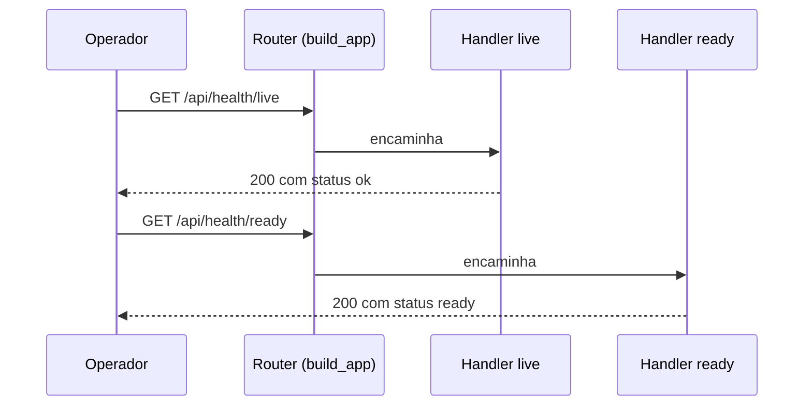
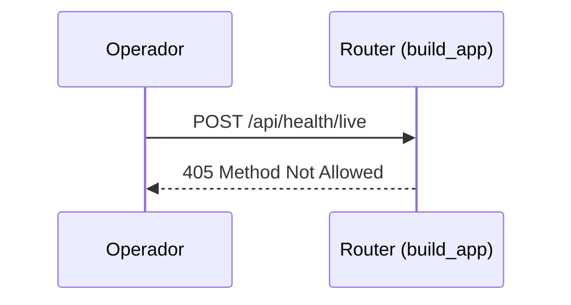

# Rotas de health: live e ready - Tech spec

Demanda DEM-20261114-health-live-ready · 2026-11-14 · Proposed branch: `feat/health-live-ready`

## Context

Adicionar `GET /api/health/live` e `GET /api/health/ready` ao backend do `medsafari` (monorepo `repos/medsafari`, subprojeto `backend/`) sem alterar `GET /api/health` (ST-01 a ST-04, BR-01 a BR-08).

Estado atual: o backend é um único crate (`backend`) com tudo em `backend/src/main.rs`: trait `VersionProvider`, `AppState`, struct `Health`, handler `health`, `build_app` (uma rota, `/api/health`), `main` e testes. Não há banco, autenticação, OpenAPI nem workspace multi-crate [INF-01] [INF-04] [INF-05]. O frontend consome só `/api/health` e não é afetado [INF-06].

Decisões desta spec:
- As novas rotas seguem o padrão atual: handlers simples em `main.rs`, registrados em `build_app`. Não há port nem use case para a prontidão, pois ela é sempre verdadeira (BR-03) [INF-02].
- Um tipo de resposta `Status { status: &'static str }` serve às duas rotas (`"ok"` em live, `"ready"` em ready); nenhuma delas chama `VersionProvider` (BR-06).
- O 405 para métodos diferentes de GET vem do comportamento padrão do `get(...)` do Axum e é provado por teste (BR-05, BR-08) [INF-03].
- Comandos de build e teste rodam em `repos/medsafari/backend` (o `Cargo.toml` não está na raiz do monorepo) [INF-08].
- O preparo de ferramentas (perfis do nextest e lefthook) entra como item habilitador, conforme a decisão de adaptar o repo ao padrão [INF-07] [INF-11].

## Sources

- Graphify: `knowledge/repositories/medsafari/graphify-out/GRAPH_REPORT.md` (comunidades `main.rs` e `app.ts`; nós centrais `health()`, `build_app()`, `VersionProvider`, `AppState`, `Health`, `HealthService`). `graph.json` não foi consultado.
- Arquivos lidos em `repos/medsafari`: `backend/src/main.rs`, `backend/Cargo.toml`, `backend/.cargo/config.toml`, `backend/docs/requests.http`, `frontend/src/app/api/health.service.ts`, `frontend/src/app/app.ts` (grep por health), `frontend/proxy.conf.json`, `frontend/package.json`.
- Guides: `## Quick rules` de `knowledge/guides/backend/code-patterns-backend.md`.
- Entrada: `delivery/01-functional-stories.md` (aprovado em 2026-11-14).

## Impact by layer

| Layer | Repo | Module / file | Change | Refs | Persistence |
|---|---|---|---|---|---|
| adapters-http (hoje no crate único) | medsafari | `backend/src/main.rs`: tipo `Status`, handlers `live` e `ready`, rotas em `build_app` | Adicionar `GET /api/health/live` e `GET /api/health/ready` | ST-01, ST-02 / AC-01, AC-02, AC-03, AC-04 / BR-01, BR-02, BR-03, BR-06 | no |
| adapters-http (testes) | medsafari | `backend/src/main.rs`, módulo `tests` | Testes de live, ready, acesso sem credenciais e 405 | ST-01, ST-02, ST-03 / AC-01 a AC-04, AC-06, AC-07 / BR-05, BR-08 | no |
| adapters-http (existente) | medsafari | `health`, teste `health_retorna_200_com_status_ok_e_versao_do_mock` | Sem mudança; o teste existente cobre a regressão | ST-03 / AC-05 / BR-04 | no |
| domain / application | medsafari | (nenhum) | Sem mudança: sem port nem use case [INF-02] | - | no |
| adapters-postgres / migrations | medsafari | (nenhum) | Sem mudança | - | no |
| Contrato OpenAPI (utoipa) | medsafari | (inexistente no repo) | Sem mudança [INF-05] | - | no |
| bootstrap | medsafari | `main` | Sem mudança | - | no |
| Angular | medsafari | `frontend/src/app/api/health.service.ts` | Sem mudança; segue consumindo `/api/health` [INF-06] | ST-03 / AC-05 / BR-04 | no |
| Documentação | medsafari | `backend/docs/requests.http` | Incluir os GET de live e ready | ST-04 / AC-08 / BR-07 | no |
| Ferramentas (habilitador) | medsafari | `backend/.config/nextest.toml`, `lefthook.yml` | Criar perfis `unit` e `integration` e o hook de pre-commit do backend | habilitador, sem ST/AC/BR | no |

## Sequence diagrams

Fluxo principal (UC-01): sondas de live e ready.

Fluxo de exceção (E1): método diferente de GET.

## Work decomposition

| WD | Layer | Repo | Description | Refs (ST / AC / BR) | Persistence | Depends on |
|---|---|---|---|---|---|---|
| WD-00 | ferramentas | medsafari (backend/) | Criar `backend/.config/nextest.toml` com os perfis `unit` e `integration` e `lefthook.yml` na raiz do repo com `fmt`, `clippy` e `unit` do backend (`root: backend/`) | habilitador (sem ST/AC/BR) | no | - |
| WD-01 | adapters-http | medsafari (backend/) | Escrever os testes (RED) e depois o tipo `Status`, os handlers `live` e `ready` e as rotas em `build_app`; incluir testes de acesso sem credenciais e de 405; manter o teste existente de `/api/health` verde | ST-01, ST-02, ST-03 / AC-01, AC-02, AC-03, AC-04, AC-05, AC-06, AC-07 / BR-01, BR-02, BR-03, BR-04, BR-05, BR-06, BR-08 | no | WD-00 |
| WD-02 | documentação | medsafari (backend/) | Incluir os GET de live e ready em `backend/docs/requests.http` (AC-08 é verificado por `grep` no VERIFY) [INF-09] | ST-04 / AC-08 / BR-07 | no | WD-01 |

Itens `persistence = yes`: nenhum. Todas as tasks são `unit`; Docker não é necessário.

## Risks

| ID | Risk | Impact | Mitigation |
|---|---|---|---|
| R-01 | O repo é um único crate e diverge dos guides (workspace multi-crate hexagonal) | Código novo fora do padrão alvo | Seguir o padrão atual nesta demanda; migração para workspace é demanda própria (INF-01 pede confirmação) |
| R-02 | `ready` sempre 200 pode esconder falhas quando surgirem dependências | Instância marcada pronta sem estar | Isolar o handler `ready`; OQ-02 define o 503 quando houver dependência |
| R-03 | `lefthook`, `docker` e `sqlx` não estão instalados nesta máquina | `lefthook run pre-commit` não roda no VERIFY | Instalar o lefthook antes do VERIFY ou registrar "não executado" no relatório; Docker e sqlx não são necessários aqui |
| R-04 | Perfil `integration` sem testes: o nextest retorna erro quando nada casa | Falha falsa se for executado | Não executar `integration` nesta demanda (sem persistence); se executar, usar `--no-tests=pass` |
| R-05 | `cargo clippy ... -D warnings` sem `--all-targets` não lê os testes | Avisos nos testes passam despercebidos | O repo já tem o alias `cargo lint` (`clippy --all-targets -- -D warnings`); preferi-lo no VERIFY (INF-12) |
| R-06 | Os steps do Termite assumem `Cargo.toml` e `package.json` na raiz do repo | Preflight falha em monorepo | Rodar os comandos em `repos/medsafari/backend` e registrar a adaptação no plano |
| R-07 | Filtros do nextest (`default-filter`, `kind(test)`) são propostos nos guides | Perfis podem não filtrar como esperado | Conferir com `cargo nextest list --profile unit` e `--profile integration` em WD-00 |

## Inferences

| ID | Statement | Origin | Confidence | Needs human confirmation? |
|---|---|---|---|---|
| INF-01 | O backend continua no crate único `backend`; sem workspace multi-crate nesta demanda | `backend/Cargo.toml` (um `[package]`), guides de backend | high | yes |
| INF-02 | Sem port nem use case para a prontidão (sempre pronta, BR-03) | BR-03, suposição de projeto | medium | no |
| INF-03 | `get(handler)` do Axum devolve 405 para outros métodos na mesma rota | comportamento do Axum (suposição), provado por AC-07 | high | no |
| INF-04 | Não existe camada de autenticação a contornar (BR-05) | `main.rs` lido, graphify sem nós de auth | high | no |
| INF-05 | Não há OpenAPI/utoipa no repo, logo não há contrato a atualizar | `backend/Cargo.toml` | high | no |
| INF-06 | O frontend não é afetado: `HealthService` chama só `/api/health` | graphify, `health.service.ts`, `proxy.conf.json` | high | no |
| INF-07 | Os perfis do nextest seguem o formato proposto nos guides; `integration` fica sem testes nesta demanda | guide de testes de backend (`[PROPOSED]`) | medium | no |
| INF-08 | Os comandos Rust rodam em `repos/medsafari/backend` | layout do monorepo (graphify, `ls`) | high | no |
| INF-09 | AC-08 (documentação) é verificado por `grep` no VERIFY, sem teste automatizado | suposição | high | no |
| INF-10 | Uma única branch `feat/health-live-ready` em `medsafari` cobre backend e docs (monorepo) | schema (`branches[]` por repo), natureza da mudança | high | no |
| INF-11 | O `lefthook.yml` entra na demanda mesmo sem o lefthook instalado nesta máquina | decisão de adaptar o repo ao padrão | medium | yes |
| INF-12 | No VERIFY, usar `cargo lint` (alias existente) no lugar de `cargo clippy --workspace -- -D warnings` | `backend/.cargo/config.toml` | medium | yes |
