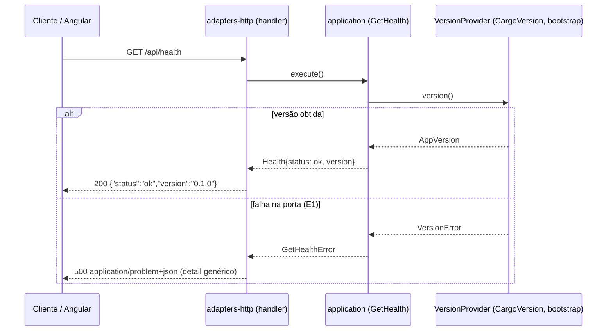
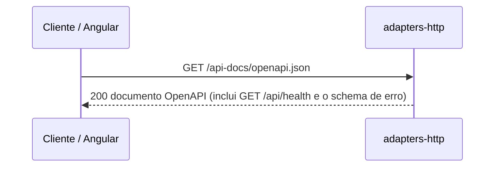

# Refatorar backend Rust para arquitetura hexagonal - Tech spec

Demand DEM-20261118-refatorar-backend-hexagonal · 2026-11-18 · Proposed branch: `refactor/backend-hexagonal` [INF-13]

## Context

O backend (`repos/medsafari/backend`) é um crate único com um só `src/main.rs` (163 linhas): trait `VersionProvider`, `CargoVersion`, `AppState`, DTO `Health`, handler `health`, `build_app`, `main` e testes. Expõe apenas `GET /api/health` em `127.0.0.1:3000`; o frontend Angular o consome via proxy (`/api` -> `127.0.0.1:3000`, `health.service.ts`).

A demanda converte o backend em um workspace hexagonal (`domain`, `application`, `adapters-http`, `bootstrap`) preservando o contrato do health (BR-01), publica o OpenAPI em `GET /api-docs/openapi.json` (BR-06), padroniza erros em `application/problem+json` (BR-05) e entrega o ferramental dos guias: `cargo-nextest` (perfil `unit`), `lefthook`, e as dependências `thiserror`, `async-trait`, `utoipa`, `sqlx`, `mockall`, `tracing`, `tower-http` no nível do workspace (BR-08 a BR-10). Ficam fora `adapters-postgres`, migrations, perfil `integration`, autenticação, middlewares e frontend (BR-11).

Decisões de desenho:
- **Domain:** value object `AppVersion` (texto não vazio) e `DomainError`; sem I/O nem framework. O conteúdo é mínimo porque o health não tem regra de negócio real [INF-01].
- **Application:** porta `VersionProvider` síncrona e falível (`Result<AppVersion, VersionError>`), pois ler a versão não faz I/O assíncrono; `async-trait` fica declarada para portas futuras [INF-02]. Caso de uso `GetHealth` devolve `Health { status: Ok, version }` ou `GetHealthError`. A porta usa `cfg_attr(any(test, feature = "mocks"), automock)` para permitir mock em outros crates [INF-03].
- **adapters-http:** router, handler fino, DTO `HealthResponse` (`ToSchema`), `ApiError` -> problem+json (500 com `detail` genérico, sem expor a causa interna [INF-04]), documento `ApiDoc` do `utoipa` servido por um handler `Json(ApiDoc::openapi())`, sem `utoipa-axum` nem swagger-ui [INF-05]. O handler usa o `GetHealth` concreto; os testes de handler mockam a porta [INF-06].
- **bootstrap:** `CargoVersion` (implementa `VersionProvider` com `env!("CARGO_PKG_VERSION")`), endereço de escuta como constante `127.0.0.1:3000` sem override por ambiente [INF-07], DI manual e `main`. O binário continua se chamando `backend` via `[[bin]]` [INF-08]; a versão vem de `[workspace.package]` para continuar `0.1.0`.
- **Dependências:** `sqlx`, `tracing` e `tower-http` ficam só em `[workspace.dependencies]`, sem membro que as use [INF-09].

## Sources

Graphify (`knowledge/repositories/medsafari/graphify-out/`):
- `GRAPH_REPORT.md` (comunidade `main.rs`: `AppState`, `build_app`, `CargoVersion`, `Health`, `health`, `main`, `VersionProvider`; sem ciclos de importação; god nodes `health()`, `VersionProvider`, `build_app()`).

Arquivos lidos em `repos/medsafari/` (apenas onde o graphify apontou):
- `backend/src/main.rs`, `backend/Cargo.toml`, `backend/docs/` (vazio de interesse)
- `frontend/proxy.conf.json`, `frontend/src/app/api/health.service.ts` (consumidor do contrato)
- `.gitignore`

Guias: `knowledge/guides/commons/*`, `backend/*` (code-patterns, development, middlewares, testing-unit); `database/*` apenas para confirmar que nada de persistência é necessário (BR-11).

## Impact by layer

| Layer | Repo | Module/file | Change | Refs | persistence |
|---|---|---|---|---|---|
| workspace | medsafari | `backend/Cargo.toml` | Vira `[workspace]` (`members = ["crates/*"]`, resolver 3, edition 2024, `[workspace.package]`, `[workspace.dependencies]` com as dependências dos guias) | ST-02, ST-04, AC-04, AC-12, AC-13, BR-02, BR-10, BR-11 | no |
| workspace | medsafari | `backend/.config/nextest.toml` | Perfil `unit` (sem Docker) | ST-04, AC-09, BR-08, BR-10 | no |
| domain | medsafari | `backend/crates/domain/` | `AppVersion`, `DomainError` | ST-02, AC-04, BR-03 | no |
| application (ports) | medsafari | `backend/crates/application/` | Porta `VersionProvider`, `VersionError`, caso de uso `GetHealth`, `GetHealthError`, feature `mocks` | ST-01, ST-02, AC-01, AC-03, AC-05, BR-04, BR-05 | no |
| adapters-http | medsafari | `backend/crates/adapters-http/` | Router, handler `/api/health`, `HealthResponse`, `ApiError` problem+json, `ApiDoc` + rota `/api-docs/openapi.json` | ST-01, ST-03, AC-01, AC-03, AC-07, AC-08, BR-01, BR-05, BR-06 | no |
| bootstrap | medsafari | `backend/crates/bootstrap/` | `CargoVersion`, constante de endereço, DI manual, `main`; `[[bin]] name = "backend"` | ST-01, ST-02, AC-01, AC-02, AC-06, BR-01, BR-04, BR-07 | no |
| bootstrap (testes) | medsafari | `backend/crates/bootstrap/tests/` | Teste da regra de dependência via `cargo metadata` [INF-12] | ST-02, AC-04, AC-13, BR-02, BR-03, BR-11 | no |
| tooling | medsafari | `lefthook.yml` (raiz do repo git) [INF-11] | Hooks `fmt`, `clippy`, `unit` com `root: backend/` | ST-04, AC-10, AC-11, BR-09 | no |
| removido | medsafari | `backend/src/main.rs` | Conteúdo redistribuído pelos crates; remover o crate raiz | ST-02, BR-02 | no |

Regra de dependência verificada: `domain` não depende de ninguém; `application` -> `domain`; `adapters-http` -> `application`, `domain`; `bootstrap` -> todos. Nenhum desenho viola `domain <- application <- adapters <- bootstrap`. Nenhum item toca `adapters-postgres` ou `migrations`.

## Sequence diagrams

### UC-01 Consultar a saúde (caminho principal e falha)

### UC-01 fluxo alternativo 1a: contrato OpenAPI

UC-02 é um fluxo de desenvolvimento (TDD, commit com hooks) e não passa pelo hexágono; é coberto por WD-01 e WD-07, sem diagrama.

## Work decomposition

| WD | layer | repo | description | refs (ST/AC/BR) | persistence | depends on |
|---|---|---|---|---|---|---|
| WD-01 | workspace | medsafari | Converter `backend/` em workspace; `[workspace.dependencies]` com `thiserror`, `async-trait`, `utoipa`, `sqlx` (sem uso), `mockall`, `tracing`, `tower-http` (+ `axum`, `tokio`, `serde`); `.config/nextest.toml` com perfil `unit`; esqueleto dos 4 crates | ST-02, ST-04, AC-04, AC-09, AC-12, AC-13, BR-02, BR-08, BR-10, BR-11 | no | - |
| WD-02 | domain | medsafari | `AppVersion` (valida não vazio) e `DomainError`, testes primeiro | ST-02, AC-04, BR-03 | no | WD-01 |
| WD-03 | application | medsafari | Porta `VersionProvider` + `VersionError`; caso de uso `GetHealth` com porta mockada; `GetHealthError`; feature `mocks` | ST-01, ST-02, AC-01, AC-03, AC-05, BR-04, BR-05, BR-08 | no | WD-02 |
| WD-04 | adapters-http | medsafari | Handler fino, `HealthResponse`, `ApiError` -> problem+json, `ApiDoc` e rota OpenAPI; testes de handler via `oneshot` | ST-01, ST-03, AC-01, AC-03, AC-07, AC-08, BR-01, BR-05, BR-06 | no | WD-03 |
| WD-05 | bootstrap | medsafari | `CargoVersion`, constante de endereço, DI manual, `main` sem lógica, `[[bin]] backend`; remover o `main.rs` antigo; testes de `CargoVersion` e do endereço | ST-01, ST-02, AC-01, AC-02, AC-06, BR-01, BR-04, BR-07 | no | WD-04 |
| WD-06 | bootstrap (testes) | medsafari | Teste que lê `cargo metadata` e falha se a regra de dependência for violada ou se existir `sqlx`/crate Postgres em uso | ST-02, AC-04, AC-13, BR-02, BR-03, BR-11 | no | WD-05 |
| WD-07 | tooling | medsafari | `lefthook.yml` (`fmt`, `clippy -D warnings`, `unit`) e `lefthook install`; confirmar recusa de commit com código não conforme | ST-04, AC-10, AC-11, BR-09 | no | WD-05 |

Cobertura: AC-01..AC-13 e BR-01..BR-11 aparecem em ao menos um item. AC-06 é verificado por revisão no VERIFY (checklist: `main.rs` só com configuração e fiação) [INF-10].

## Risks

| ID | risk | impact | mitigation |
|---|---|---|---|
| R-01 | Converter para workspace muda o nome do binário e o caminho de `cargo run` | Quebra de scripts e do fluxo local do frontend/backend | `[[bin]] name = "backend"` em `bootstrap`; verificar `cargo run -p bootstrap` e o proxy do frontend no VERIFY |
| R-02 | `mockall` não gera mocks entre crates com `cfg(test)` | Testes de handler sem como mockar a porta | Feature `mocks` em `application`, habilitada como dev-dependency em `adapters-http` |
| R-03 | `utoipa` e `axum` com versões incompatíveis | Falha de compilação ou OpenAPI incompleto | Fixar versões no workspace; teste do documento (AC-07) |
| R-04 | Sintaxe do filtro do nextest (GAPS #5) não confirmada | Perfil `unit` roda testes errados | Validar com `cargo nextest list --profile unit` na WD-01 |
| R-05 | Exemplos dos guias não foram compilados (GAPS #10) | Retrabalho na implementação | TDD por camada; ajustar o guia se o exemplo falhar |
| R-06 | `lefthook.yml` na raiz do repo git também afeta o frontend | Hook roda em commits que só tocam o frontend | `root: backend/` e `glob: "backend/**"` por comando |
| R-07 | Dependências declaradas sem uso (`sqlx`, `tracing`, `tower-http`) | Ruído; ferramentas de higiene podem acusar | Declarar só no workspace; revisar na demanda que as usar |
| R-08 | `clippy -D warnings` com edition 2024 pode acusar código dos guias | Commit recusado | Corrigir o código; `#[allow]` só com comentário do motivo (guia) |
| R-09 | `target/` e `Cargo.lock` existentes mudam de forma na conversão | Diff grande no lock | Esperado; commitar o `Cargo.lock` junto |

## Inferences

| ID | statement | origin | confidence | needs human confirmation? |
|---|---|---|---|---|
| INF-01 | Domínio mínimo (`AppVersion`, `DomainError`) basta, sem regra de negócio real | `main.rs` lido (health sem regra); guia code-patterns | medium | no |
| INF-02 | Porta `VersionProvider` síncrona e falível | OQ-01 (proposta aceita no default); guia pede `async_trait` só para portas assíncronas | medium | yes |
| INF-03 | Mock da porta exposto por feature `mocks` | guia code-patterns (`mocks` feature, [PROPOSED]) | high | no |
| INF-04 | Erro interno vira 500 com `detail` genérico, tipo `about:blank` | guia code-patterns (exemplo `ApiError`); AC-03 | high | no |
| INF-05 | OpenAPI servido por `Json(ApiDoc::openapi())`, sem `utoipa-axum`/swagger-ui | guia pede apenas `utoipa`; BR-10 não lista outros crates | medium | no |
| INF-06 | Handler usa `GetHealth` concreto; teste mocka a porta, não o caso de uso | guia testing-unit pede "fake use case"; simplificação | medium | no |
| INF-07 | Endereço de escuta fixo, sem override por variável de ambiente | AC-02 (sem configuração adicional); `main.rs` lido | high | no |
| INF-08 | Binário mantém o nome `backend` | `Cargo.toml` lido (package `backend`) | high | no |
| INF-09 | `sqlx`, `tracing` e `tower-http` só em `[workspace.dependencies]`, sem membro usando | OQ-02, OQ-03; BR-10, BR-11 | high | yes |
| INF-10 | AC-06 é verificado por revisão no VERIFY, não por teste automático | natureza do AC (conteúdo do `main.rs`) | medium | no |
| INF-11 | `lefthook.yml` fica na raiz do repo git `medsafari` com `root: backend/` | repo lido (git root contém `backend/` e `frontend/`); guia diz "backend repo" | medium | yes |
| INF-12 | Regra de dependência verificada por teste com `cargo metadata` | guia code-patterns (dependency rule); AC-04 | low | yes |
| INF-13 | Tipo de branch `refactor`, slug `backend-hexagonal` | natureza da mudança; padrão da branch | high | no |
