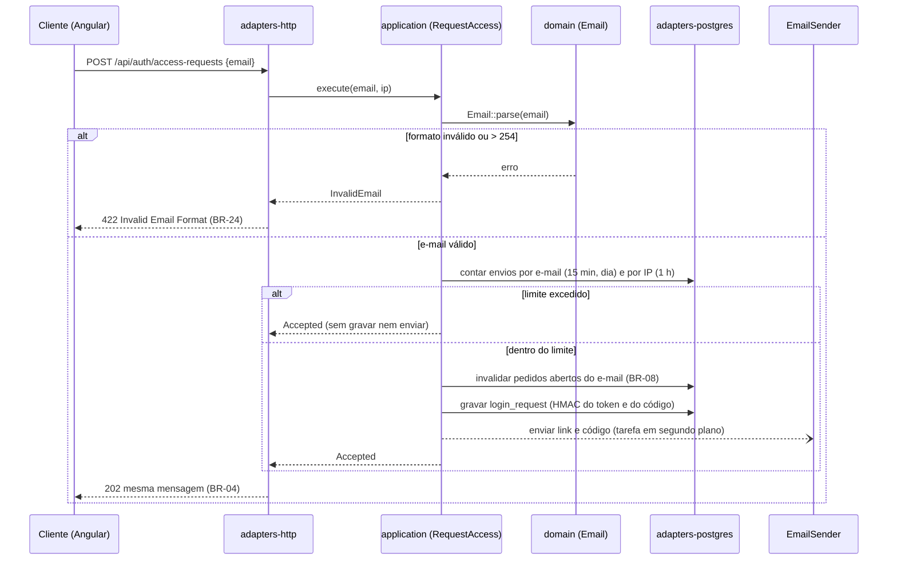
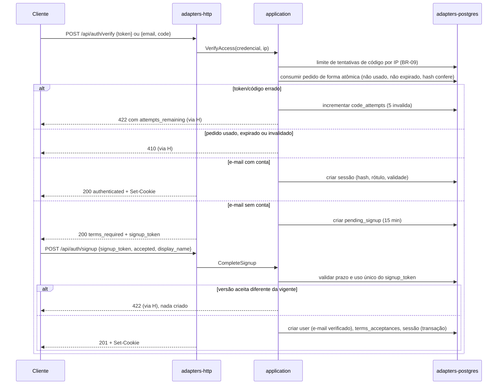
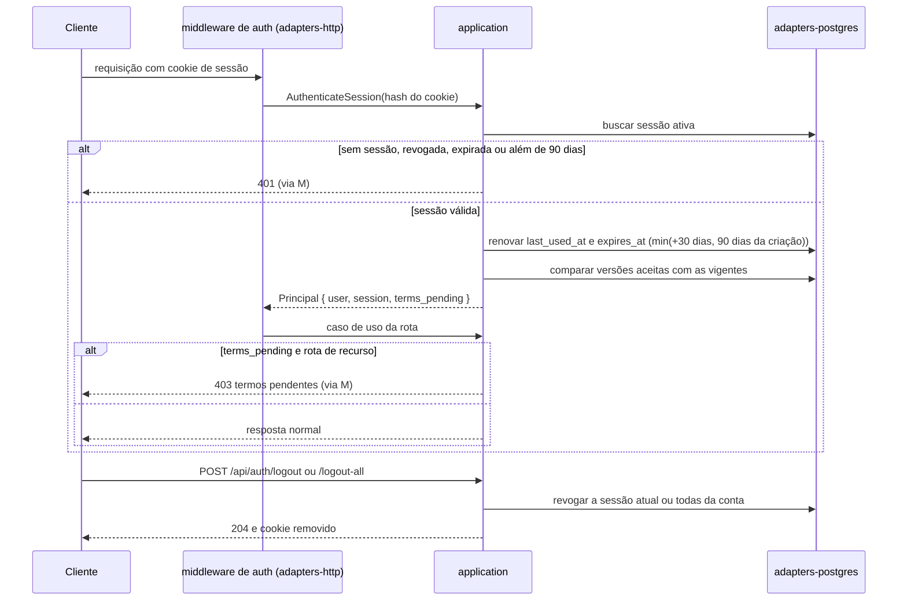
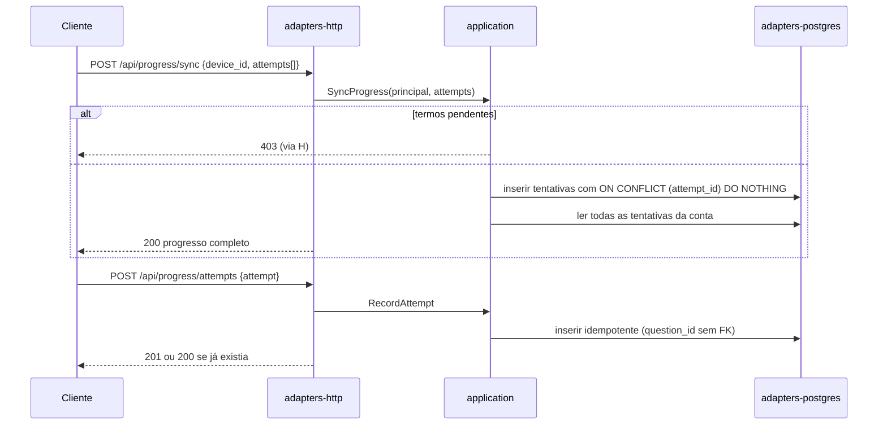

# Cadastro, login e sessão - backend - Tech spec

Demanda DEM-20261118-login-register-backend · 2026-11-18 · Proposed branch: `feat/login-register-backend` (repositório `medsafari`).

## Context

Implementa, no backend Rust/Axum do monorepo `medsafari`, o módulo 01 da coleta: pedido de acesso por e-mail com link e código, confirmação, criação de conta com aceite de termos, sessão em cookie, logout e recebimento idempotente do progresso de estudo (ST-01 a ST-08, AC-01 a AC-33, BR-01 a BR-24).

Pontos que moldam o desenho:

- O backend hoje é só um esqueleto hexagonal com `GET /api/health`: não há banco, `adapters-postgres`, migrações, `tracing`, configuração por ambiente nem relógio. Tudo isso nasce nesta demanda.
- Resposta idêntica ao pedido de acesso (BR-04) vale também sob limite excedido; por isso o envio do e-mail não pode alterar o corpo nem o tempo de resposta de forma observável [INF-11].
- O link do e-mail abre uma rota do frontend; o token só é consumido por um `POST` explícito, o que cumpre BR-20 sem página no backend [INF-01].
- Token e código são guardados como HMAC-SHA256 com segredo do servidor [INF-05].
- O estado "e-mail confirmado, termos pendentes" é uma tabela própria com token opaco de 15 minutos [INF-03], e o progresso é enviado em um endpoint de sincronização separado da confirmação [INF-04].
- Fora desta demanda (resposta humana): provedor real de e-mail (só adaptador de desenvolvimento), rotina de retenção, validação de `question_id`, lista de dispositivos, textos dos termos.

## Sources

Graphify consultado:
- `knowledge/repositories/medsafari/graphify-out/GRAPH_REPORT.md` (grafo gerado no commit `7f1a5fea`; o repositório está em `787529d`, então o grafo está defasado e foi complementado por leitura direta).

Arquivos lidos em `repos/medsafari`:
- `backend/Cargo.toml`, `backend/crates/{domain,application,adapters-http,bootstrap}/Cargo.toml`
- `backend/crates/domain/src/lib.rs`, `backend/crates/application/src/lib.rs`
- `backend/crates/adapters-http/src/{lib,error,health,openapi}.rs`
- `backend/crates/bootstrap/src/{lib,main}.rs`, `backend/crates/bootstrap/tests/architecture.rs`
- `backend/.config/nextest.toml`, `lefthook.yml`, `frontend/proxy.conf.json`, `CLAUDE.md`

Guides aplicados: `commons/code-patterns-general.md`, `commons/testing-guide-unit-general.md`, `backend/{code-patterns,development-guide,middlewares-guide,testing-guide-unit}-backend.md`. Os guides de `database` não existem em `knowledge/guides/database/`; as regras de SQL seguem `code-patterns-general.md` [INF-14].

Fatos do repositório que afetam o plano:
- `architecture.rs` tem o teste `ac_13_br_11_no_postgres_crate_and_no_sqlx_user`, que **proíbe** o crate `adapters-postgres` e qualquer uso de `sqlx`. Ele precisa ser substituído nesta demanda, e `ALLOWED` ganha `adapters-postgres`.
- `nextest.toml` só tem o perfil `unit`, sem filtro; o comentário do arquivo pede `default-filter` excluindo o `adapters-postgres` quando ele existir, e o perfil `integration` ainda não existe.
- `sqlx` está no `[workspace.dependencies]` com `default-features = false` e nenhuma feature; `tracing` e `tower-http` também estão declarados e sem uso.
- `ApiError` hoje só mapeia `GetHealthError` e responde sempre 500; precisa virar um erro genérico de API.
- `LISTEN_ADDR` é constante; `main.rs` usa `expect` (permitido só em `bootstrap`).

## Impact by layer

Todas as linhas são do repo `medsafari`, pasta `backend/`.

| Layer | Module / file | Change | Refs | Persistence |
|---|---|---|---|---|
| domain | `crates/domain` (`email.rs`, `terms.rs`, `session.rs`, `progress.rs`, `error.rs`) | Value objects `Email` (normalização, formato, 254 caracteres), `AccessCode` (6 dígitos), `DocumentVersion`, `DisplayName` (limite de 80 caracteres [INF-17]); entidades `Attempt` e política de sessão (30 dias deslizantes, 90 absolutos); `uuid` e `time` como tipos de valor [INF-08]; `DomainError` ampliado | ST-01, ST-03, ST-04, ST-08; AC-03, AC-04, AC-19, AC-21, AC-22; BR-05, BR-11, BR-15, BR-24 | não |
| application | `crates/application` portas (`ports.rs`) | Portas `Clock`, `IdGenerator`, `SecretGenerator` (token, código, id de sessão), `TokenHasher`, `EmailSender`, `LoginRequestRepository`, `UserRepository`, `SessionRepository`, `PendingSignupRepository`, `AttemptRepository`, `TermsPolicy` (versão vigente) e `AuthSettings` (validades e limites); todas com `mockall::automock` | todas as ST; BR-02, BR-06, BR-09, BR-13 | não |
| application | `use_cases/request_access.rs`, `verify_access.rs`, `complete_signup.rs` | `RequestAccess` (limites, invalida anteriores, gera token e código, grava hash, dispara o envio), `VerifyAccess` (link ou código, uso único, 5 erros, limite por IP, sessão ou `terms_required`), `CompleteSignup` (valida versão e prazo, cria conta, aceites e sessão) | ST-01, ST-02, ST-03; AC-01 a AC-19; BR-01 a BR-09, BR-13, BR-15, BR-20 a BR-22, BR-24 | não |
| application | `use_cases/session.rs` | `AuthenticateSession` (valida, renova, calcula `terms_pending`), `GetSession`, `AcceptTerms`, `Logout`, `LogoutAll` | ST-04, ST-05, ST-06; AC-20 a AC-27; BR-10 a BR-14, BR-23 | não |
| application | `use_cases/progress.rs` | `SyncProgress` (lote idempotente + devolve progresso completo) e `RecordAttempt`; ambos recusam se há termos pendentes [INF-16] | ST-07, ST-08, ST-06; AC-26, AC-28 a AC-33; BR-14, BR-16 a BR-19 | não |
| migrations | `crates/adapters-postgres/migrations/0001_auth.sql`, `0002_attempts.sql` | Tabelas `users`, `login_requests`, `pending_signups` [INF-03], `sessions`, `terms_acceptances`, `code_attempt_log` [INF-10], `attempts` com índices e unicidade de `users.email` e de `attempts.attempt_id` | ST-01 a ST-08; BR-05, BR-06, BR-08, BR-09, BR-16, BR-18, BR-19, BR-22 | **sim** |
| adapters-postgres | novo crate `crates/adapters-postgres` | Repositórios com `sqlx` (consultas sem macros) [INF-07]; consumo atômico de token e de tentativas de código; contagem de limites; `ON CONFLICT DO NOTHING` em `attempts`; migração embutida | ST-01 a ST-08; AC-01 a AC-33; BR-05 a BR-12, BR-16 a BR-19, BR-22 | **sim** |
| adapters-http | `crates/adapters-http/src/auth/` e `progress/` | Rotas, DTOs `ToSchema`, handlers finos, extração e emissão do cookie de sessão, middleware de autenticação com `from_fn_with_state`, mapeamento de erros para `application/problem+json`, anotações `utoipa` | ST-01 a ST-08; AC-01 a AC-33; BR-04, BR-10, BR-12, BR-20, BR-24 | não |
| adapters-http | `error.rs`, `lib.rs`, `openapi.rs` | `ApiError` passa a mapear qualquer erro de aplicação (400, 401, 403, 409/410, 422, 500) mantendo o corpo problem+json; `router` recebe um estado agregado; `ApiDoc` inclui as novas rotas | BR-04, BR-24 | não |
| bootstrap | `config.rs`, `infra.rs`, `lib.rs`, `main.rs` | Configuração por ambiente; adaptadores de relógio, geração aleatória, HMAC-SHA256 e e-mail de desenvolvimento [INF-06]; pool `sqlx`, migração na subida [INF-13]; fiação manual dos casos de uso; `tracing` | BR-02, BR-06, BR-09, BR-10, BR-13 | não |
| tests | `bootstrap/tests/architecture.rs`; `.config/nextest.toml` | Trocar `ac_13_br_11...` por teste que exige `adapters-postgres` só dependendo de `application`/`domain`, e adicionar o crate em `ALLOWED`; perfil `unit` com `default-filter = "not package(adapters-postgres)"` e perfil `integration` | todos | **sim** |

Regra de dependência: `domain <- application <- (adapters-postgres, adapters-http) <- bootstrap`. Os adaptadores não dependem um do outro, e a infraestrutura (relógio, HMAC, e-mail) fica em `bootstrap` para não violar a regra [INF-06].

## API contract

Contrato proposto para o frontend, com prefixo `/api`. Tudo em JSON; erros em `application/problem+json` com `type`, `title`, `status`, `detail`. A forma definitiva vem do OpenAPI gerado por `utoipa` [INF-12].

| Rota | Auth | Entrada | Saída | Erros |
|---|---|---|---|---|
| `POST /api/auth/access-requests` | não | `{ "email" }` | `202 { "message" }`, sempre o mesmo texto (BR-04) | `422` título `Invalid Email Format` (BR-24) |
| `POST /api/auth/verify` | não | `{ "token" }` ou `{ "email", "code" }` [INF-02] | `200 { "status": "authenticated" }` com `Set-Cookie`, ou `200 { "status": "terms_required", "signup_token", "expires_at", "terms": { "termos", "privacidade" } }` | `410` acesso já usado ou expirado, `422` código inválido com `attempts_remaining`, `429` limite por IP |
| `POST /api/auth/signup` | não | `{ "signup_token", "accepted": { "termos", "privacidade" }, "display_name"? }` | `201` com `Set-Cookie` | `410` prazo vencido ou token usado, `422` versão diferente da vigente |
| `GET /api/auth/session` | cookie | - | `200 { "email", "display_name", "terms_pending": bool, "current_terms": {...} }` (sem `user_id`) | `401` |
| `POST /api/auth/terms` | cookie | `{ "accepted": { "termos", "privacidade" } }` | `204` | `401`, `422` versão diferente da vigente |
| `POST /api/auth/logout` | cookie | - | `204`, cookie removido | `401` |
| `POST /api/auth/logout-all` | cookie | - | `204`, cookie removido | `401` |
| `POST /api/progress/sync` | cookie | `{ "schema_version": 1, "device_id", "attempts": [...] }` | `200 { "schema_version": 1, "attempts": [...] }` (progresso completo da conta) | `401`, `403` termos pendentes |
| `POST /api/progress/attempts` | cookie | uma tentativa `{ attempt_id, question_id, selected_option, is_correct, answered_at }` | `201` nova, `200` já existia | `401`, `403` termos pendentes, `422` |

Cookie `__Host-` não é usado em dev; nome e atributos: `session`, `HttpOnly`, `Secure`, `SameSite=Lax`, `Path=/` (BR-10).

## Sequence diagrams

### Pedido de acesso (UC-01, passos 1 e 2)

### Confirmação e criação de conta (UC-01, passos 3 e 4)

### Requisição autenticada, termos e logout (UC-02)

### Progresso (UC-03)

## Work decomposition

| WD | layer | repo | description | refs (ST/AC/BR) | persistence | depends on |
|---|---|---|---|---|---|---|
| WD-01 | domain | medsafari | `Email`, `AccessCode`, `DocumentVersion`, `DisplayName`, `Attempt`, política de sessão e `DomainError` | ST-01, ST-03, ST-04, ST-08; AC-03, AC-04, AC-19, AC-21, AC-22, AC-33; BR-05, BR-11, BR-15, BR-19, BR-24 | no | - |
| WD-02 | application | medsafari | Portas (relógio, ids, segredos, hash, e-mail, repositórios, política de termos), erros de aplicação e `AuthSettings`, com mocks | ST-01 a ST-08; BR-02, BR-06, BR-09, BR-13 | no | WD-01 |
| WD-03 | application | medsafari | Casos de uso `RequestAccess`, `VerifyAccess`, `CompleteSignup` | ST-01, ST-02, ST-03; AC-01 a AC-19; BR-01 a BR-09, BR-13, BR-15, BR-20 a BR-22, BR-24 | no | WD-02 |
| WD-04 | application | medsafari | Casos de uso `AuthenticateSession`, `GetSession`, `AcceptTerms`, `Logout`, `LogoutAll` | ST-04, ST-05, ST-06; AC-20 a AC-27; BR-10 a BR-14, BR-23 | no | WD-02 |
| WD-05 | application | medsafari | Casos de uso `SyncProgress` e `RecordAttempt` | ST-06, ST-07, ST-08; AC-26, AC-28 a AC-33; BR-14, BR-16 a BR-19 | no | WD-02 |
| WD-06 | migrations | medsafari | Migrações das sete tabelas com índices e unicidades; perfil `integration` do nextest e `default-filter` do `unit` | ST-01 a ST-08; BR-05, BR-06, BR-08, BR-09, BR-16, BR-18, BR-19, BR-22 | yes | WD-02 |
| WD-07 | adapters-postgres | medsafari | Crate `adapters-postgres` e repositórios com consumo atômico, contagens de limite, transação de criação de conta e testes de integração (testcontainers); atualizar `architecture.rs` | ST-01 a ST-08; AC-01 a AC-33; BR-05 a BR-12, BR-16 a BR-19, BR-22 | yes | WD-06 |
| WD-08 | adapters-http | medsafari | Rotas, DTOs, cookie de sessão, middleware de auth, `ApiError` genérico e OpenAPI de `auth/*` | ST-01 a ST-06; AC-01 a AC-27; BR-04, BR-10, BR-12, BR-13, BR-14, BR-20, BR-23, BR-24 | no | WD-03, WD-04 |
| WD-09 | adapters-http | medsafari | Rotas, DTOs e OpenAPI de `progress/*` | ST-06, ST-07, ST-08; AC-26, AC-28 a AC-33; BR-14, BR-16 a BR-19 | no | WD-05, WD-08 |
| WD-10 | bootstrap | medsafari | Configuração por ambiente, adaptadores de infraestrutura (relógio, aleatoriedade, HMAC, e-mail de desenvolvimento), pool, migração na subida, fiação dos casos de uso, `tracing` | ST-01 a ST-08; BR-02, BR-06, BR-09, BR-10, BR-13 | no | WD-07, WD-08, WD-09 |

Cobertura dos AC por item: AC-01 a AC-19 em WD-03 e WD-08; AC-20 a AC-27 em WD-04 e WD-08; AC-28 a AC-33 em WD-05 e WD-09. Os testes de integração de WD-07 repetem os critérios que dependem do banco (uso único, 5 erros, limites, idempotência).

## Risks

| ID | risk | impact | mitigation |
|---|---|---|---|
| R-01 | Primeira camada de banco do projeto: nenhum padrão de migração, pool ou teste de integração existe | Retrabalho de estrutura nas próximas demandas | Fixar nesta demanda: `sqlx` sem macros, migração em `adapters-postgres`, testcontainers e perfis do nextest |
| R-02 | Migrações novas, sem dados anteriores | Sem backfill nem compatibilidade; futuras alterações de `attempts` (FK de questão) precisam de migração própria | Manter `question_id` sem FK e documentar a evolução no módulo 03 |
| R-03 | Corrida no consumo do token e na contagem de erros de código | Uso duplo do link ou mais de 5 tentativas | `UPDATE ... WHERE used_at IS NULL AND expires_at > now() RETURNING`, incremento atômico e teste de integração concorrente |
| R-04 | Código de 6 dígitos tem 10^6 valores; um hash simples vazado é revertido por força bruta | Quebra do uso único se a tabela vazar | HMAC com segredo do servidor [INF-05]; limites por pedido e por IP |
| R-05 | Diferença de tempo ou de corpo entre e-mail com e sem conta, ou com limite excedido | Enumeração de contas (BR-04) | Resposta idêntica; envio em segundo plano [INF-11]; teste que compara as respostas |
| R-06 | IP vem do socket ou de cabeçalho de proxy; `X-Forwarded-For` é forjável | Limites por IP burlados ou aplicados ao proxy | Cabeçalho só quando configurado como confiável [INF-09] |
| R-07 | Adaptador de e-mail de desenvolvimento registra link e código em log, contra a regra de nunca logar segredos | Vazamento se rodar em produção | Habilitar só com `APP_ENV=dev`; recusar subida em produção sem provedor real |
| R-08 | Renovação de sessão grava no banco a cada requisição autenticada | Carga de escrita | Aceitável no piloto; reavaliar com dados reais |
| R-09 | `ALLOWED` do teste de arquitetura e a proibição de `sqlx` seriam violadas pelo novo crate | `cargo nextest` falha | Atualizar `architecture.rs` em WD-07, antes de adicionar o crate |
| R-10 | Grafo defasado (commit `7f1a5fea` contra `787529d`) | Impacto subestimado | Leitura direta dos arquivos; Termite roda `graphify update` ao final |
| R-11 | Cookie `Secure` com front e API em origens diferentes ou em HTTP | Cookie não gravado em ambientes não locais | Mesma origem (resposta humana); `localhost` é contexto seguro [INF-15] |

## Inferences

| ID | statement | origin | confidence | needs human confirmation? |
|---|---|---|---|---|
| INF-01 | O link do e-mail aponta para uma rota do frontend (`APP_BASE_URL/...?token=`) e o token só é consumido por `POST /api/auth/verify`; assim, abrir o link não consome nada | assumption, apoiada em `00-split.md` e coleta seção 6.1 | medium | yes |
| INF-02 | Confirmação por código envia `{email, code}`; por link, `{token}` | assumption (o código sozinho não identifica o pedido) | high | no |
| INF-03 | O estado "e-mail confirmado, termos pendentes" é guardado em `pending_signups` e devolvido como `signup_token` opaco no corpo, com 15 minutos | assumption, derivada de BR-21 e BR-22 | medium | yes |
| INF-04 | O progresso é enviado em `POST /api/progress/sync`, separado da confirmação; a "resposta de entrada" de BR-17 é a resposta desse endpoint | assumption | medium | yes |
| INF-05 | Token e código são guardados como HMAC-SHA256 com um segredo de servidor (`AUTH_SECRET`), não como SHA-256 puro | assumption (a coleta pede hash SHA-256) | medium | yes |
| INF-06 | Relógio, aleatoriedade, HMAC e e-mail de desenvolvimento ficam em `bootstrap`, seguindo o precedente `CargoVersion`, sem criar crate fora dos guides | repo file read (`bootstrap/src/lib.rs`) e guide de padrões | medium | yes |
| INF-07 | Consultas `sqlx` usam `query()` com `bind`, sem macros e sem metadados `.sqlx/` offline; o workspace habilita as features `runtime-tokio`, `postgres`, `migrate`, `uuid` e `time` | repo file read (`Cargo.toml`) | high | no |
| INF-08 | Os tipos `time::OffsetDateTime` e `uuid::Uuid` podem entrar no domínio como tipos de valor, sem violar a regra "sem I/O nem runtime" | guide de padrões do backend | high | no |
| INF-09 | O IP do cliente vem de `ConnectInfo<SocketAddr>`; um cabeçalho de proxy confiável é opcional por configuração | assumption | medium | yes |
| INF-10 | "Envios" para o limite são os `login_requests` criados; pedidos barrados por limite não são gravados. As tentativas de código por IP ficam na tabela `code_attempt_log`, fora do rascunho da coleta | coleta seções 6.3 e 11 | medium | no |
| INF-11 | O e-mail é enviado numa tarefa em segundo plano depois de gravar o pedido; falha de envio só gera log e não muda a resposta | assumption, derivada de BR-04 | medium | yes |
| INF-12 | Rotas, códigos de status e formato dos erros do quadro "API contract" são proposta minha; o contrato final é o OpenAPI gerado | assumption | medium | yes |
| INF-13 | As migrações rodam na subida do servidor, em `bootstrap` | assumption | high | no |
| INF-14 | Sem guides de `database`, as regras de SQL (snake_case, tabelas no plural, FK `<singular>_id`) vêm de `code-patterns-general.md` | guide rule | high | no |
| INF-15 | O cookie mantém `Secure` também em desenvolvimento, pois navegadores tratam `localhost` como contexto seguro | assumption | medium | no |
| INF-16 | O bloqueio por termos pendentes é aplicado nos casos de uso `SyncProgress` e `RecordAttempt` (autorização na aplicação), e não no middleware; `session`, `terms` e `logout` seguem permitidos | guide de middlewares | high | no |
| INF-17 | O nome de exibição é aparado e limitado a 80 caracteres; acima disso o pedido é recusado com `422` | assumption (a coleta não define limite) | low | yes |
