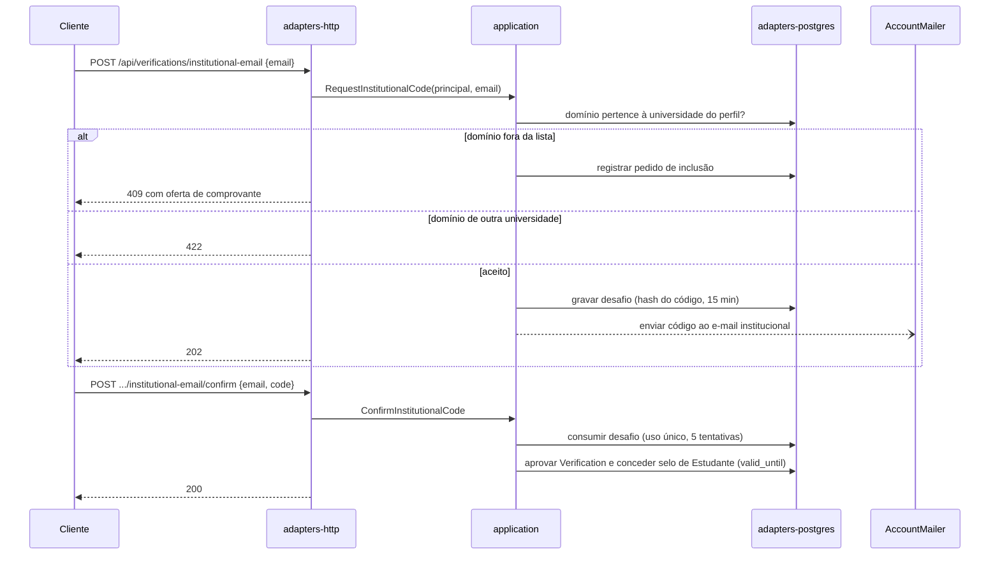
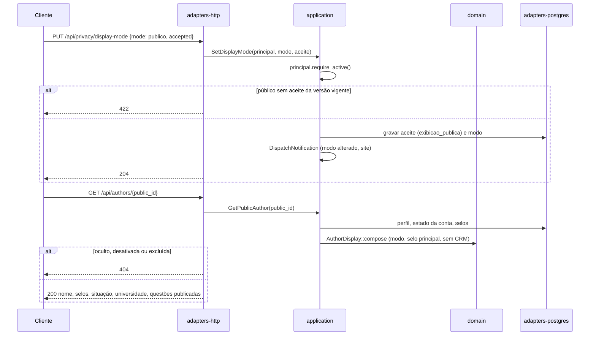
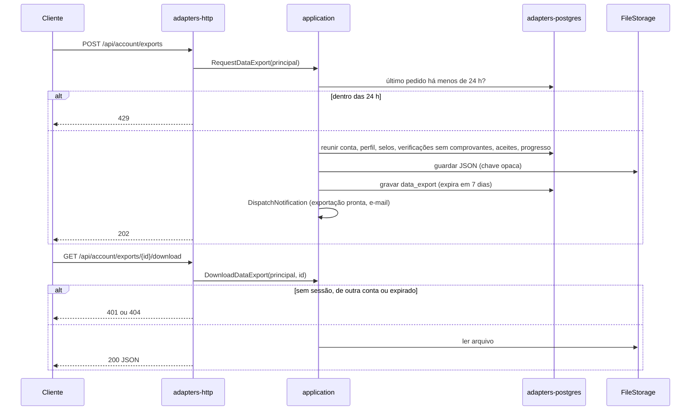

# Perfil, selos e conta - backend - Tech spec

Demanda DEM-20261125-user-profile-account-backend · 2026-11-25 · Proposed branch: `feat/user-profile-account-backend` (repositório `medsafari`).

## Context

Implementa, no backend Rust/Axum do monorepo `medsafari` (pasta `backend/`), o módulo 02 da coleta: perfil acadêmico, verificação (e-mail institucional, CRM, residência, pós-graduação, matrícula), selos, privacidade de exibição, desativação e exclusão da conta, exportação de dados e a API da fila manual da equipe (ST-01 a ST-14, AC-01 a AC-69, BR-01 a BR-43).

Pontos que moldam o desenho:

- O backend já tem os módulos `auth`, `progress` e `health`, em `crates/<crate>/src/modules/<modulo>/{entities,value_objects,errors,ports,repositories,usecases,controllers,dtos,...}`. Os novos módulos seguem esse layout: `profile`, `verification`, `badges`, `privacy`, `account` e `notifications` [INF-01].
- A conta ganha estado (`ativa`, `desativada`, `exclusao_agendada`, `suspensa`) e um sinal de equipe. O estado vem junto com a sessão, sem consulta extra por requisição [INF-02].
- Conta desativada que entra de novo recebe uma sessão normal, mas só pode consultar a sessão, sair e reativar; todo o resto exige conta `ativa` [INF-03]. Conta em exclusão agendada que entra é reativada na hora (AC-58). Conta suspensa não entra [INF-04].
- A equipe é uma conta única, criada por script de shell (resposta ao OQ-04), com `users.is_staff = true`. Ela entra pelo login normal, e os casos de uso da fila checam o papel [INF-05].
- A tabela `questions` não existe (resposta ao OQ-03). O backend entrega só o cálculo do selo principal e a montagem da exibição do autor; o número de questões publicadas vem de uma porta com provedor que devolve zero até o módulo 03 [INF-06].
- Comprovantes ficam atrás de uma porta de armazenamento privado, com implementação em disco local (resposta ao OQ-05). A exportação reutiliza a mesma porta [INF-07].
- As rotinas (retenção de 90 dias, exclusões vencidas, expiração e aviso de selo de Estudante, limpeza de exportações) rodam em um binário `jobs` de execução única, agendado fora do processo da API [INF-08].
- Fora desta demanda: telas, tabela e gestão de `questions`, comentários e contestações (módulo 03), denúncia de breve histórico (OQ-06), webservice do CFM (D-12), provedor real de e-mail e de armazenamento, carga real das listas de referência.

## Sources

Graphify consultado:
- `knowledge/repositories/medsafari/graphify-out/GRAPH_REPORT.md` (grafo do commit `01ab7b12`; o repositório está em `43cb914`, então o grafo está defasado e foi complementado por leitura direta [INF-09]).

Arquivos lidos em `repos/medsafari/backend`:
- `Cargo.toml`, `crates/adapters-postgres/migrations/0001_auth.sql`, `0002_attempts.sql`, `crates/adapters-postgres/src/pg_store.rs`
- `crates/adapters-postgres/src/modules/auth/repositories/user.repository.rs`
- `crates/application/src/{lib,settings}.rs`, `modules/auth/mod.rs`, `modules/auth/repositories/{user,session}.repository.rs`, `modules/auth/ports/{email_sender,terms_policy}.port.rs`, `modules/auth/usecases/{session_service,verify_access}.usecase.rs`, `shared/ports/clock.port.rs`
- `crates/adapters-http/src/{state,router}.rs`, `modules/auth/middlewares/require_session.middleware.rs`
- `crates/bootstrap/src/{config,wiring}.rs`, `modules/auth/auth.module.rs`
- `dev/db.sh` (cabeçalho) e a listagem de arquivos dos cinco crates

Guides aplicados: `commons/{code-patterns,project-structure,testing-guide-unit}-general.md`, `backend/{code-patterns,development-guide,middlewares-guide,structure-guide,testing-guide-unit}-backend.md` e `database/{code-patterns,development-guide,testing-testcontainers-guide}-database.md` (carregados porque há migrações).

Fatos do repositório que afetam o plano:
- `users` tem `deleted_at` e as consultas de `UserRepository` filtram por ele, mas não há `status`, nem papel de equipe.
- `terms_acceptances.document` tem `CHECK IN ('termos','privacidade')` e `user_id` com `ON DELETE CASCADE`. Isso impede aceitar o termo de exibição pública e impede guardar aceites sem ligação com a pessoa após a exclusão (BR-38).
- `Principal` hoje é `{ user_id, session_id, terms_pending }` e `SessionRecord` não traz dados da conta.
- `require_session` recebe `State<Arc<AuthApi>>`; um segundo estado de API exige trocar o estado do middleware.
- `Config` exige `TERMS_VERSION` e `PRIVACY_VERSION`; `APP_ENV=prod` ainda é recusado (sem provedor real de e-mail).
- As migrações existentes não têm `.down.sql` e usam consultas sem macros (`sqlx::query`) [INF-10].

## Impact by layer

Todas as linhas são do repo `medsafari`, pasta `backend/`. Regra de layout (`commons/project-structure-general.md`): cada arquivo `<name>.<kind>.rs` tem seu teste em `__tests__/<name>.<kind>.test.rs` na mesma pasta; as colunas abaixo listam o arquivo de código e o teste correspondente fica implícito, exceto nos testes de integração, que têm caminho próprio. `mod.rs` de cada pasta declara os arquivos e reexporta.

| Layer | Module / file | Change | Refs | Persistence |
|---|---|---|---|---|
| domain | `crates/domain/src/modules/account/value_objects/account_status.value_object.rs` | `AccountStatus` (ativa, desativada, exclusao_agendada, suspensa) com as transições permitidas | ST-11, ST-12; AC-53, AC-55, AC-57, AC-58; BR-35, BR-36, BR-37 | não |
| domain | `modules/account/errors/account.error.rs` | `AccountError` (transição inválida, conta suspensa) | ST-11, ST-12; BR-35 a BR-37 | não |
| domain | `modules/profile/value_objects/{full_name,bio,lattes_url,situation,academic_year,crm_number,brazilian_uf,institution_text}.value_object.rs` | Validações de limite e formato: nome até 120, histórico até 500 em texto simples, Lattes só `lattes.cnpq.br`, situação de 4 valores, ano com 4 dígitos, CRM só dígitos, 27 UFs | ST-01; AC-04, AC-06, AC-07; BR-03, BR-04 | não |
| domain | `modules/profile/entities/{profile,crm_registration,residency,postgraduate}.entity.rs` | `Profile` com a regra de perfil completo (estudante: nome, situação, universidade; médico exige também ano de conclusão); entradas de CRM, residência e pós-graduação com estado em curso/concluída | ST-01; AC-01 a AC-03, AC-05, AC-08, AC-09; BR-01, BR-02, BR-03, BR-05, BR-06 | não |
| domain | `modules/profile/errors/profile.error.rs` | `ProfileError` | ST-01; BR-04 | não |
| domain | `modules/verification/value_objects/{verification_status,verification_item_type,verification_method,rejection_reason,evidence_file,observed_crm_status,person_name_match}.value_object.rs` | Status (não enviado, pendente, aprovado, recusado, revogado), tipos e métodos, motivos de recusa da lista, validação de arquivo (PDF/JPG/PNG, até 5 MB, assinatura do conteúdo), situação observada do CRM (só `ativa` gera selo) e comparação de nomes sem acentos e maiúsculas [INF-11] | ST-03 a ST-07; AC-14, AC-16, AC-20, AC-21, AC-25, AC-27, AC-28, AC-31, AC-32, AC-36; BR-07, BR-14, BR-16, BR-20 a BR-23 | não |
| domain | `modules/verification/entities/{verification,institutional_email_challenge}.entity.rs` | `Verification` com as transições pendente → aprovado/recusado → revogado, motivo obrigatório na recusa e na revogação, atraso além de 7 dias úteis [INF-19]; desafio de e-mail institucional (código, validade de 15 min, 5 tentativas, uso único, reutilizando `AccessCode` do `auth` [INF-20]) | ST-02, ST-04, ST-07; AC-10, AC-11, AC-12, AC-34, AC-36, AC-38; BR-07, BR-12, BR-23, BR-24, BR-26 | não |
| domain | `modules/verification/errors/verification.error.rs` | `VerificationError` | ST-02 a ST-07; BR-07, BR-23 | não |
| domain | `modules/badges/value_objects/badge_type.value_object.rs`, `modules/badges/entities/badge.entity.rs` | `BadgeType` (estudante, medico, residente, especialista, mestre, doutor), selo com `detail`, `valid_until` e `revoked_at`; função do selo principal pela ordem Doutor → Estudante; vencimento do selo de Estudante (conclusão prevista + 1 ano) | ST-08, ST-09; AC-39 a AC-41, AC-43, AC-44; BR-08, BR-09, BR-10, BR-13, BR-27, BR-28 | não |
| domain | `modules/privacy/value_objects/display_mode.value_object.rs`, `modules/privacy/entities/author_display.entity.rs` | `DisplayMode` (publico, oculto padrão); `AuthorDisplay` montado a partir de modo, perfil, selos, estado da conta e selo guardado, sem o número do CRM | ST-10; AC-45 a AC-52; BR-29 a BR-34 | não |
| domain | `modules/notifications/value_objects/notification_kind.value_object.rs` | `NotificationKind` com os eventos da seção 11 da coleta e o canal de cada um | ST-14; AC-67 a AC-69; BR-42 | não |
| application | `crates/application/src/modules/auth/repositories/{user,session}.repository.rs`, `usecases/{session_service,verify_access}.usecase.rs` | `User` e `SessionRecord` passam a carregar `status` e `is_staff`; `Principal` ganha `account_status` e `is_staff`, com `require_active()` e `require_staff()`; `VerifyAccess` cancela a exclusão agendada e recusa conta suspensa | ST-11, ST-12; AC-55, AC-58; BR-35, BR-36, BR-37 | não |
| application | `modules/profile/{repositories,usecases}/` (`profile`, `crm_registration`, `residency`, `postgraduate`, `university`, `specialty`; `get_profile`, `update_profile`, `add_crm_registration`, `remove_crm_registration`, `add_residency`, `remove_residency`, `add_postgraduate`, `remove_postgraduate`, `list_universities`, `list_specialties`) | Portas e casos de uso do perfil; o nome travado só muda com nova verificação; vários CRMs, residências e pós-graduações | ST-01, ST-04; AC-01 a AC-09, AC-22; BR-01 a BR-06, BR-17 | não |
| application | `modules/verification/ports/file_storage.port.rs`, `modules/verification/repositories/{verification,institutional_email_challenge,email_domain}.repository.rs` | Porta de armazenamento privado (guardar, ler, apagar); repositórios de verificação (fila por ordem de chegada, conflito de CRM), do desafio de e-mail institucional e da lista de domínios com pedido de inclusão | ST-02 a ST-07; AC-10 a AC-14, AC-19, AC-28 a AC-38; BR-07, BR-11, BR-12, BR-15, BR-22 a BR-26, BR-43 | não |
| application | `modules/verification/usecases/{submit_verification,list_my_verifications,request_institutional_code,confirm_institutional_code,list_verification_queue,get_verification_for_review,decide_verification,revoke_verification,confirm_fraud,purge_expired_evidence}.usecase.rs` | Envio de comprovante e CRM, status do usuário, código e confirmação do e-mail institucional, fila da equipe, decisão com motivo e registro de decisor, revogação por reconferência, fraude confirmada, retenção de 90 dias | ST-02 a ST-07, ST-09; AC-10 a AC-38, AC-43, AC-44; BR-07, BR-11 a BR-28 | não |
| application | `modules/badges/{repositories/badge.repository,usecases/{list_badges,grant_badges_for_verification,expire_student_badges,warn_expiring_student_badges}}.rs` | Concessão a partir da verificação aprovada (inclui Especialista por RQE ou título), consulta de selos e selo principal, expiração e aviso de 30 dias | ST-08, ST-04; AC-15 a AC-18, AC-39 a AC-42; BR-08, BR-09, BR-10, BR-13, BR-19 | não |
| application | `modules/privacy/{ports/{public_display_terms_policy,published_questions_counter}.port.rs,repositories/display_consent.repository.rs,usecases/{preview_display,set_display_mode,get_public_author,resolve_author_display}.usecase.rs}` | Prévia dos dois modos, troca de modo com aceite versionado do termo de exibição, página pública por `public_id`, montagem da exibição do autor (conta excluída, desativada, sem selo) | ST-10; AC-45 a AC-52; BR-29 a BR-34 | não |
| application | `modules/account/{repositories/{account,data_export}.repository.rs,usecases/{deactivate_account,reactivate_account,schedule_account_deletion,execute_due_deletions,request_data_export,download_data_export,purge_expired_exports}.usecase.rs}` | Pausa e reativação, exclusão agendada com confirmação pelo e-mail digitado, execução da exclusão com anonimização, exportação JSON com limite de 24 h e link de 7 dias | ST-11 a ST-13; AC-53 a AC-66; BR-35 a BR-41 | não |
| application | `modules/notifications/{ports/account_mailer.port.rs,repositories/notification.repository.rs,usecases/{dispatch_notification,list_notifications,mark_notification_read}.usecase.rs}` | E-mails de conta atrás de uma porta, avisos no site, despacho que respeita a conta desativada (só e-mails ligados à conta) | ST-14, ST-06, ST-08, ST-11 a ST-13; AC-42, AC-54, AC-67 a AC-69; BR-35, BR-42 | não |
| application | `crates/application/src/settings.rs` | Novas validades e limites (código institucional 15 min e 5 tentativas, SLA da fila 7 dias úteis, carência 30 dias, link de exportação 7 dias, intervalo 24 h, retenção 90 dias, aviso 30 dias) | BR-12, BR-22, BR-26, BR-37, BR-41 | não |
| migrations | `crates/adapters-postgres/migrations/0003_account_status.sql` | `users.status` (CHECK nos 4 valores, padrão `ativa`), `deletion_due_at`, `is_staff`; `terms_acceptances`: aceita `exibicao_publica` [INF-18], `user_id` passa a `ON DELETE SET NULL` e anulável | ST-10, ST-12; AC-46, AC-53 a AC-60; BR-29, BR-35 a BR-38 | **sim** |
| migrations | `0004_profiles_and_reference.sql` | `universities`, `university_email_domains`, `medical_specialties`, `profiles` (inclui `public_id`, `display_mode`, `full_name_locked`), `crm_registrations`, `residencies`, `postgraduates` | ST-01, ST-04; AC-01 a AC-09; BR-01 a BR-06, BR-17, BR-30 | **sim** |
| migrations | `0005_reference_seed.sql` | Carga mínima de exemplo: algumas universidades, domínios e especialidades (OQ-02) [INF-17] | AC-10, AC-17; BR-05, BR-12, BR-19 | **sim** |
| migrations | `0006_verifications_and_badges.sql` | `verifications`, `institutional_email_challenges`, `email_domain_requests`, `badges`; unicidade parcial de CRM verificado (`number`, `uf`) | ST-02 a ST-09; AC-10 a AC-44; BR-07 a BR-28, BR-43 | **sim** |
| migrations | `0007_notifications_and_exports.sql` | `notifications`, `data_exports` | ST-13, ST-14; AC-63 a AC-69; BR-41, BR-42 | **sim** |
| adapters-postgres | `modules/auth/repositories/{user,session}.repository.rs` | `status`, `is_staff` nas consultas; `find_active` traz os dados da conta por junção | ST-11, ST-12; AC-55, AC-58; BR-35 a BR-37 | **sim** |
| adapters-postgres | `modules/profile/repositories/*.repository.rs` (`profile`, `crm_registration`, `residency`, `postgraduate`, `university`, `specialty`) | Persistência do perfil e das listas de referência | ST-01; AC-01 a AC-09, AC-22; BR-01 a BR-06, BR-17 | **sim** |
| adapters-postgres | `modules/verification/repositories/*.repository.rs` (`verification`, `institutional_email_challenge`, `email_domain`), `modules/badges/repositories/badge.repository.rs` | Fila ordenada, conflito de CRM, consumo atômico do código, selos | ST-02 a ST-09; AC-10 a AC-44; BR-07 a BR-28, BR-43 | **sim** |
| adapters-postgres | `modules/account/repositories/{account,data_export}.repository.rs`, `modules/privacy/repositories/display_consent.repository.rs`, `modules/notifications/repositories/notification.repository.rs` | Mudança de estado, agendamento e execução da exclusão em transação (aceites sem ligação à pessoa), exportação, consentimento de exibição, avisos | ST-10 a ST-14; AC-45 a AC-69; BR-29, BR-35 a BR-42 | **sim** |
| adapters-http | `crates/adapters-http/src/{error,state,router,openapi}.rs`, `modules/auth/middlewares/require_session.middleware.rs` | `ApiError` ganha 403, 404, 409, 413 e 415; middleware passa a receber `Arc<SessionService>`; novos estados `AccountApi` e `StaffApi`; rotas novas no OpenAPI; limite de corpo de 5 MB nas rotas de upload | todas as ST | não |
| adapters-http | `modules/profile/{controllers,dtos}/`, `modules/verification/{controllers,dtos}/`, `modules/badges/...`, `modules/privacy/...`, `modules/account/...`, `modules/notifications/...`, `modules/staff/...` | Controllers finos e DTOs `ToSchema` de cada rota do contrato abaixo; upload multipart; download com sessão | ST-01 a ST-14 | não |
| bootstrap | `config.rs`, `wiring.rs`, `modules/{profile,verification,badges,privacy,account,notifications}/*.module.rs` | Novas variáveis (`PUBLIC_DISPLAY_TERMS_VERSION`, `STORAGE_DIR`); fiação manual dos casos de uso; `AccountApi` e `StaffApi` | todas as ST | não |
| bootstrap | `modules/verification/providers/local_file_storage.provider.rs`, `modules/notifications/providers/log_account_mailer.provider.rs`, `modules/privacy/providers/{env_public_display_terms,zero_published_questions}.provider.rs` | Armazenamento em disco (diretório privado, nomes opacos, sem caminho vindo do usuário), e-mail de conta em log, versão do termo por ambiente, contador de questões igual a zero [INF-06] | ST-06, ST-10, ST-14; AC-28 a AC-30, AC-46, AC-67 a AC-69; BR-22, BR-29, BR-30, BR-42 | não |
| bootstrap | `src/bin/jobs.rs` | Binário de execução única com subcomandos `purge-evidence`, `execute-deletions`, `expire-badges`, `warn-badges`, `purge-exports` [INF-08] | ST-06, ST-08, ST-12, ST-13; AC-29, AC-41, AC-42, AC-59, AC-66; BR-13, BR-22, BR-37, BR-38, BR-41 | não |
| tooling | `dev/create-staff.sh`, `docs/requests.http`, `docs/subir-e-testar-o-backend.md` | Script que cria a conta única de equipe (`is_staff = true`) no Postgres de desenvolvimento; exemplos das rotas novas; como agendar `jobs` | ST-07; AC-33 a AC-35; BR-24 | não |
| tests | `crates/adapters-postgres/tests/{profiles,verifications,badges,account,notifications,schema}.rs`, `crates/bootstrap/tests/{account_flow,staff_flow}.rs`, `crates/bootstrap/tests/architecture.rs` | Integração dos adaptadores, fluxo completo pela API (perfil → CRM → fila → selo → modo público → exclusão), e o teste de arquitetura segue exigindo a regra de dependência | todos | **sim** |

Regra de dependência: `domain <- application <- (adapters-postgres, adapters-http) <- bootstrap`. Os adaptadores não dependem um do outro; armazenamento, e-mail e contador de questões são portas implementadas em `bootstrap`.

## API contract

Prefixo `/api`; JSON, exceto onde indicado; erros em `application/problem+json`. A forma definitiva vem do OpenAPI gerado por `utoipa` e o frontend regenera o cliente a partir dele. Toda rota exige sessão, salvo `GET /api/authors/{public_id}`. "Ativa" = só conta `ativa`; "Equipe" = `is_staff`.

| Rota | Quem | Entrada | Saída | Erros |
|---|---|---|---|---|
| `GET /api/auth/session` (existente) | sessão | - | acrescenta `account_status`, `is_staff` | `401` |
| `GET /api/profile` | ativa | - | perfil, `complete`, CRMs, residências, pós-graduações | `401`, `403` |
| `PUT /api/profile` | ativa | `full_name`, `situation`, `preparing_residency`, `university_id` ou `foreign_university`, anos, `bio`, `lattes_url` | `200` perfil | `422` limite ou formato, `409` nome travado |
| `POST /api/profile/crm-registrations`, `DELETE /api/profile/crm-registrations/{id}` | ativa | `number`, `uf` | `201` / `204` | `422`, `409` |
| `POST /api/profile/residencies`, `DELETE .../{id}`; `POST /api/profile/postgraduates`, `DELETE .../{id}` | ativa | campos das seções 4.5 e 4.6 | `201` / `204` | `422` |
| `GET /api/reference/universities?q=`, `GET /api/reference/specialties` | ativa | - | listas | - |
| `GET /api/verifications` | ativa | - | status de cada item (`nao_enviado`, `pendente`, `aprovado`, `recusado` com motivo, `revogado` com motivo) | - |
| `POST /api/verifications/institutional-email`, `POST .../institutional-email/confirm` | ativa | `email` / `email`, `code` | `202` / `200` | `422` domínio de outra universidade ou código; `409` domínio fora da lista com oferta de comprovante e pedido de inclusão registrado |
| `POST /api/verifications` (multipart) [INF-13] | ativa | `item_type`, `item_id`, arquivo | `201` pendente | `413` acima de 5 MB, `415` formato, `422` |
| `GET /api/badges` | ativa | - | selos ativos e `primary` | - |
| `GET /api/privacy/preview` | ativa | - | prévia dos dois modos | - |
| `PUT /api/privacy/display-mode` | ativa | `mode`, `accepted_public_display_terms?` | `204` | `422` aceite ausente ou versão diferente |
| `GET /api/authors/{public_id}` [INF-12] | pública | - | página pública do autor (sem CRM) | `404` se oculto, desativado ou excluído |
| `POST /api/account/deactivate` | ativa | - | `204`, sessões encerradas | `401` |
| `POST /api/account/reactivate` | desativada | - | `204` | `409` |
| `POST /api/account/deletion` | ativa | `email_confirmation` | `202 { "deletion_due_at" }` | `422` e-mail diferente |
| `POST /api/account/exports`, `GET /api/account/exports/{id}/download` [INF-14] | ativa | - | `202` / arquivo JSON | `429` segundo pedido em 24 h, `404` expirado ou de outra conta, `401` sem sessão |
| `GET /api/notifications`, `POST /api/notifications/{id}/read` [INF-15] | ativa | - | lista / `204` | - |
| `GET /api/staff/verifications?status=pendente` | equipe | - | fila por ordem de chegada, com `overdue` e `crm_conflict` | `403` |
| `GET /api/staff/verifications/{id}`, `GET .../{id}/file` | equipe | - | dados do perfil e do pedido / comprovante | `403`, `404` |
| `POST /api/staff/verifications/{id}/approve` | equipe | `observed_status?`, `rqe_specialties?` | `204`, selos concedidos | `403`, `409` já decidido |
| `POST /api/staff/verifications/{id}/reject` | equipe | `reason` (lista), `note?` | `204` | `422` sem motivo |
| `POST /api/staff/verifications/{id}/revoke` | equipe | `reason`, `observed_status?` | `204`, selo revogado e usuário avisado | `403`, `409` |
| `POST /api/staff/users/{user_id}/fraud` | equipe | `note` | `204`, selos revogados, conta suspensa | `403` |
| `GET /api/staff/domain-requests` [INF-16] | equipe | - | pedidos de inclusão de domínio | `403` |

Cookie e CORS: inalterados em relação ao módulo 01. As rotas novas ficam atrás de `require_session`; a checagem de conta ativa e de equipe é feita nos casos de uso (guia de middlewares).

## Sequence diagrams

### Envio do CRM e aprovação pela fila manual (UC-03, UC-06)

```mermaid
sequenceDiagram
    participant C as Cliente (Angular)
    participant H as adapters-http
    participant A as application
    participant D as domain
    participant S as FileStorage
    participant P as adapters-postgres
    C->>H: POST /api/verifications (multipart: CRM + carteira)
    H->>A: SubmitVerification(principal, item, arquivo)
    A->>D: EvidenceFile::validate (formato, 5 MB)
    alt arquivo inválido
        D-->>A: erro
        H-->>C: 413 ou 415 ou 422
    else válido
        A->>S: guardar arquivo (chave opaca)
        A->>P: gravar Verification pendente (marca conflito se o CRM já está verificado)
        A->>A: DispatchNotification (comprovante recebido, site)
        H-->>C: 201 pendente
    end
    Note over C,P: Equipe
    C->>H: POST /api/staff/verifications/{id}/approve
    H->>A: DecideVerification(principal, id, observed_status, rqe)
    A->>A: principal.require_staff()
    A->>D: nome do perfil x registro; situação ativa?
    alt conflito de CRM ou situação não ativa ou nome diferente
        A-->>H: erro de regra (409 ou 422)
    else aprovado
        A->>P: transação: aprovar, travar nome, conceder selos (Médico, Especialista por RQE)
        A->>A: DispatchNotification (aprovada, e-mail e site)
        H-->>C: 204
    end
```

### E-mail institucional (UC-02)



### Selo principal e exibição do autor (UC-07, UC-09)



### Desativar, reativar e cancelar exclusão ao entrar (UC-10, UC-11)

```mermaid
sequenceDiagram
    participant C as Cliente
    participant H as adapters-http
    participant A as application
    participant P as adapters-postgres
    C->>H: POST /api/account/deactivate
    H->>A: DeactivateAccount(principal)
    A->>P: transação: status = desativada; revogar todas as sessões
    A->>A: DispatchNotification (conta desativada, e-mail)
    H-->>C: 204
    Note over C,P: Mais tarde, login do módulo 01
    C->>H: POST /api/auth/verify
    H->>A: VerifyAccess
    alt status exclusao_agendada
        A->>P: status = ativa; deletion_due_at = null
        A-->>H: sessão criada, conta ativa
    else status desativada
        A-->>H: sessão criada, account_status = desativada
    else status suspensa
        A-->>H: erro, sem sessão (403)
    end
    C->>H: POST /api/account/reactivate
    H->>A: ReactivateAccount(principal)
    A->>P: status = ativa
    H-->>C: 204
```

### Exclusão agendada e execução (UC-11)

```mermaid
sequenceDiagram
    participant C as Cliente
    participant H as adapters-http
    participant A as application
    participant P as adapters-postgres
    participant S as FileStorage
    participant J as bin jobs
    C->>H: POST /api/account/deletion {email_confirmation}
    H->>A: ScheduleAccountDeletion
    alt e-mail digitado diferente
        H-->>C: 422
    else
        A->>P: status = exclusao_agendada; deletion_due_at = agora + 30 dias; revogar sessões
        A->>A: DispatchNotification (exclusão agendada, e-mail)
        H-->>C: 202 com a data
    end
    J->>A: ExecuteDueDeletions (execute-deletions)
    A->>P: contas vencidas (FOR UPDATE SKIP LOCKED)
    A->>S: apagar comprovantes e exportações da conta
    A->>P: transação: aceites sem user_id e sem ip; apagar login_requests do e-mail; apagar usuário (cascata)
    A->>A: e-mail final de confirmação
```

### Exportação dos dados (UC-12)



### Revogação e fraude (UC-08)

```mermaid
sequenceDiagram
    participant C as Cliente (equipe)
    participant H as adapters-http
    participant A as application
    participant P as adapters-postgres
    C->>H: POST /api/staff/verifications/{id}/revoke {reason, observed_status}
    H->>A: RevokeVerification(principal, id, reason)
    A->>A: require_staff()
    A->>P: transação: revogar verificação e selos derivados
    A->>A: DispatchNotification (selo revogado com motivo, e-mail e site)
    H-->>C: 204
    C->>H: POST /api/staff/users/{user_id}/fraud
    H->>A: ConfirmFraud(principal, user_id, note)
    A->>P: transação: revogar todos os selos; status = suspensa; revogar sessões; marcar questões para revisão (ver INF-06)
    H-->>C: 204
```

## Work decomposition

Ordem: domain → application → migrations → adapters-postgres → adapters-http → bootstrap → tooling e testes. Cada item cobre código e teste (`__tests__/` ou `tests/`).

| WD | layer | repo | description | refs (ST/AC/BR) | persistence | depends on |
|---|---|---|---|---|---|---|
| WD-01 | domain | medsafari | `modules/account`: `account_status.value_object.rs`, `account.error.rs` | ST-11, ST-12; AC-53, AC-55, AC-57, AC-58; BR-35, BR-36, BR-37 | no | - |
| WD-02 | domain | medsafari | `modules/profile`: value objects, entidades `profile`, `crm_registration`, `residency`, `postgraduate` e `profile.error.rs` | ST-01; AC-01 a AC-09; BR-01 a BR-06 | no | - |
| WD-03 | domain | medsafari | `modules/verification`: value objects (status, tipo, método, motivo, arquivo de comprovante, situação observada do CRM, comparação de nomes), entidades `verification` e `institutional_email_challenge`, `verification.error.rs` | ST-02 a ST-07; AC-10 a AC-14, AC-16, AC-20, AC-21, AC-23, AC-25, AC-27, AC-28, AC-31, AC-32, AC-34, AC-36, AC-38; BR-07, BR-11, BR-12, BR-14, BR-16, BR-18, BR-20 a BR-23, BR-26 | no | WD-02 |
| WD-04 | domain | medsafari | `modules/badges`: `badge_type.value_object.rs`, `badge.entity.rs` (selo principal, vencimento do Estudante) | ST-08; AC-39 a AC-41; BR-08, BR-09, BR-10, BR-13, BR-19 | no | WD-03 |
| WD-05 | domain | medsafari | `modules/privacy`: `display_mode.value_object.rs`, `author_display.entity.rs` | ST-10; AC-45 a AC-52; BR-29 a BR-34 | no | WD-04 |
| WD-06 | domain | medsafari | `modules/notifications`: `notification_kind.value_object.rs` | ST-14; AC-67 a AC-69; BR-42 | no | - |
| WD-07 | application | medsafari | `modules/auth`: `User`/`SessionRecord` com `status` e `is_staff`; `Principal::{require_active,require_staff}`; `VerifyAccess` cancela exclusão agendada e recusa suspensa; testes existentes atualizados; `settings.rs` com os novos limites | ST-11, ST-12; AC-55, AC-58; BR-35, BR-36, BR-37 | no | WD-01 |
| WD-08 | application | medsafari | `modules/profile`: portas `profile`, `crm_registration`, `residency`, `postgraduate`, `university`, `specialty` e os dez casos de uso | ST-01, ST-04; AC-01 a AC-09, AC-22; BR-01 a BR-06, BR-17 | no | WD-02, WD-07 |
| WD-09 | application | medsafari | `modules/verification` (usuário): `file_storage.port.rs`, repositórios `verification`, `institutional_email_challenge`, `email_domain`; casos `submit_verification`, `list_my_verifications`, `request_institutional_code`, `confirm_institutional_code`, `purge_expired_evidence` | ST-02, ST-03, ST-04, ST-05, ST-06; AC-10 a AC-14, AC-19, AC-24 a AC-32; BR-07, BR-11, BR-12, BR-15, BR-20 a BR-23, BR-43 | no | WD-03, WD-07 |
| WD-10 | application | medsafari | `modules/verification` (equipe): `list_verification_queue`, `get_verification_for_review`, `decide_verification`, `revoke_verification`, `confirm_fraud` | ST-04, ST-07, ST-09; AC-15 a AC-23, AC-33 a AC-38, AC-43, AC-44; BR-14 a BR-19, BR-23 a BR-28 | no | WD-09, WD-11 |
| WD-11 | application | medsafari | `modules/badges`: `badge.repository.rs`, `list_badges`, `grant_badges_for_verification`, `expire_student_badges`, `warn_expiring_student_badges` | ST-08, ST-04; AC-15 a AC-18, AC-39 a AC-42; BR-08 a BR-10, BR-13, BR-19 | no | WD-04, WD-14 |
| WD-12 | application | medsafari | `modules/privacy`: portas `public_display_terms_policy`, `published_questions_counter`, repositório `display_consent`, casos `preview_display`, `set_display_mode`, `get_public_author`, `resolve_author_display` | ST-10; AC-45 a AC-52; BR-29 a BR-34 | no | WD-05, WD-08, WD-11 |
| WD-13 | application | medsafari | `modules/account`: repositórios `account` e `data_export`; casos `deactivate_account`, `reactivate_account`, `schedule_account_deletion`, `execute_due_deletions`, `request_data_export`, `download_data_export`, `purge_expired_exports` | ST-11, ST-12, ST-13; AC-53 a AC-66; BR-35 a BR-41 | no | WD-07, WD-09, WD-14 |
| WD-14 | application | medsafari | `modules/notifications`: `account_mailer.port.rs`, `notification.repository.rs`, `dispatch_notification`, `list_notifications`, `mark_notification_read` | ST-14; AC-42, AC-54, AC-67 a AC-69; BR-35, BR-42 | no | WD-06 |
| WD-15 | migrations | medsafari | `0003_account_status.sql` e `0004_profiles_and_reference.sql` | ST-01, ST-10 a ST-12; AC-01 a AC-09, AC-46, AC-53 a AC-60; BR-01 a BR-06, BR-17, BR-29, BR-35 a BR-38 | yes | WD-01, WD-02 |
| WD-16 | migrations | medsafari | `0005_reference_seed.sql`, `0006_verifications_and_badges.sql`, `0007_notifications_and_exports.sql` | ST-02 a ST-09, ST-13, ST-14; AC-10 a AC-44, AC-63 a AC-69; BR-05, BR-07 a BR-28, BR-41, BR-42, BR-43 | yes | WD-15 |
| WD-17 | adapters-postgres | medsafari | `modules/auth/repositories/{user,session}.repository.rs` com `status`, `is_staff`; testes `tests/accounts.rs` ajustados | ST-11, ST-12; AC-55, AC-58; BR-35 a BR-37 | yes | WD-07, WD-15 |
| WD-18 | adapters-postgres | medsafari | `modules/profile/repositories/*.repository.rs` (seis) e `tests/profiles.rs` | ST-01; AC-01 a AC-09, AC-22; BR-01 a BR-06, BR-17 | yes | WD-08, WD-15 |
| WD-19 | adapters-postgres | medsafari | `modules/verification/repositories/{verification,institutional_email_challenge,email_domain}.repository.rs`, `modules/badges/repositories/badge.repository.rs`, `tests/{verifications,badges}.rs` | ST-02 a ST-09; AC-10 a AC-44; BR-07 a BR-28, BR-43 | yes | WD-10, WD-11, WD-16 |
| WD-20 | adapters-postgres | medsafari | `modules/account/repositories/{account,data_export}.repository.rs`, `modules/privacy/repositories/display_consent.repository.rs`, `modules/notifications/repositories/notification.repository.rs`, `tests/{account,notifications}.rs`, `tests/schema.rs` | ST-10 a ST-14; AC-45 a AC-69; BR-29, BR-35 a BR-42 | yes | WD-12, WD-13, WD-14, WD-16 |
| WD-21 | adapters-http | medsafari | Base: `error.rs` (403, 404, 409, 413, 415), `require_session.middleware.rs` com `Arc<SessionService>`, `state.rs` (`AccountApi`, `StaffApi`), `router.rs`, `openapi.rs`, limite de corpo; testes existentes ajustados | todas as ST; BR-24 | no | WD-07 |
| WD-22 | adapters-http | medsafari | `modules/profile` e `modules/badges`: controllers e DTOs do perfil, listas de referência e selos | ST-01, ST-08; AC-01 a AC-09, AC-22, AC-39 a AC-41; BR-01 a BR-06, BR-08 a BR-10, BR-17 | no | WD-08, WD-11, WD-21 |
| WD-23 | adapters-http | medsafari | `modules/verification`: status, e-mail institucional e upload multipart | ST-02, ST-03, ST-05, ST-06; AC-10 a AC-14, AC-24 a AC-32; BR-07, BR-11, BR-12, BR-20 a BR-23, BR-43 | no | WD-09, WD-21 |
| WD-24 | adapters-http | medsafari | `modules/staff`: fila, detalhe, arquivo, aprovar, recusar, revogar, fraude, pedidos de domínio | ST-04, ST-07, ST-09; AC-15 a AC-23, AC-33 a AC-38, AC-43, AC-44; BR-14 a BR-19, BR-23 a BR-28 | no | WD-10, WD-21 |
| WD-25 | adapters-http | medsafari | `modules/privacy`, `modules/account` e `modules/notifications`: modo de exibição, prévia, página pública, desativar, reativar, exclusão, exportação, avisos | ST-10 a ST-14; AC-42, AC-45 a AC-69; BR-29 a BR-42 | no | WD-12, WD-13, WD-14, WD-21 |
| WD-26 | bootstrap | medsafari | `config.rs` (novas variáveis), providers `local_file_storage`, `log_account_mailer`, `env_public_display_terms`, `zero_published_questions` | ST-06, ST-10, ST-14; AC-28 a AC-30, AC-46, AC-67 a AC-69; BR-22, BR-29, BR-30, BR-42 | no | WD-09, WD-12, WD-14 |
| WD-27 | bootstrap | medsafari | `modules/{profile,verification,badges,privacy,account,notifications}/*.module.rs` e `wiring.rs` | todas as ST | no | WD-22 a WD-26 |
| WD-28 | bootstrap | medsafari | `src/bin/jobs.rs` com cinco subcomandos | ST-06, ST-08, ST-12, ST-13; AC-29, AC-41, AC-42, AC-59, AC-66; BR-13, BR-22, BR-37, BR-38, BR-41 | no | WD-27 |
| WD-29 | tooling | medsafari | `dev/create-staff.sh`, `docs/requests.http`, `docs/subir-e-testar-o-backend.md` | ST-07; AC-33 a AC-35; BR-24 | no | WD-27 |
| WD-30 | tests | medsafari | `bootstrap/tests/{account_flow,staff_flow}.rs` e `architecture.rs` revisado; checa os cenários ponta a ponta | ST-01 a ST-14; AC-01 a AC-69; BR-01 a BR-43 | yes | WD-27, WD-28 |

## Risks

| ID | risk | impact | mitigation |
|---|---|---|---|
| R-01 | `0003` altera `terms_acceptances` (nova constraint de `document`, `user_id` anulável, FK recriada) | Falha ou bloqueio na migração; aceites sem dono | Tabela pequena no piloto; expandir e depois restringir em uma migração só; teste de integração aplicando as migrações do zero e sobre dados do módulo 01 |
| R-02 | Exclusão apaga dados sem volta | Perda indevida ou exclusão parcial | Execução em transação; carência de 30 dias; job idempotente com `FOR UPDATE SKIP LOCKED`; arquivos apagados antes do usuário e tolerância a arquivo já removido; teste de integração do que fica e do que sai (AC-59, AC-60) |
| R-03 | Aceites mantidos "sem ligação com dados identificáveis" dependem de definição jurídica | Retenção ou anonimização insuficiente | Aceites ficam com `user_id` nulo e `ip` vazio; prazo de guarda e texto ficam provisórios até o advogado (OQ-01) |
| R-04 | Upload de comprovantes (tipo forjado, arquivo grande, caminho) | Execução ou vazamento de arquivo | Validar assinatura do conteúdo além da extensão, limite de 5 MB no corpo, chave opaca gerada pelo servidor, diretório fora da raiz pública, sem nome vindo do cliente no caminho |
| R-05 | Comprovante e exportação em disco local | Perda de arquivo em troca de máquina; sem criptografia | Aceito para o piloto atrás da porta; provedor real em outra demanda (OQ-05); documentar permissões do diretório |
| R-06 | Conta única de equipe com acesso a todos os comprovantes | Conta comprometida expõe documentos pessoais | Conta criada por script, entrada só pelo login com link ou código do e-mail dela, trilha de quem decidiu e quando, nenhum log de documento; revisar quando houver mais de uma pessoa na equipe |
| R-07 | Sessão passa a trazer dados da conta por junção | Consulta mais pesada a cada requisição | Junção por chave primária; medir no teste de integração; índice em `sessions.user_id` já existe |
| R-08 | Mudar o estado do middleware e de `User`/`SessionRecord` quebra testes do módulo 01 | Regressão em login e sessão | Atualizar os testes existentes na mesma tarefa (WD-07, WD-17, WD-21) e manter a suíte do módulo 01 verde |
| R-09 | Comparação de nomes e normalização de acentos | Falso positivo ou negativo na checagem de nome | Normalização Unicode (NFD, sem marcas, minúsculas) isolada em um value object com testes; a decisão final continua da curadoria [INF-11] |
| R-10 | Conflito de CRM sob concorrência (duas contas aprovadas ao mesmo tempo) | Mesmo CRM verificado em duas contas | Índice único parcial sobre CRM verificado e tratamento do erro de violação como conflito |
| R-11 | Tabela `questions` não existe | Fraude e exclusão não conseguem atuar sobre questões; contador de questões é zero | Contrato das portas pronto para o módulo 03; passos sobre questões ficam como no-op documentado em INF-06 e voltam na demanda do módulo 03 |
| R-12 | `jobs` depende de agendador externo | Retenção e exclusão não rodam se ninguém agendar | Documentar o agendamento em `docs/subir-e-testar-o-backend.md`; subcomandos idempotentes; log do que cada execução fez |
| R-13 | E-mails só em log (sem provedor real) | Usuário não recebe aviso fora do desenvolvimento | `APP_ENV=prod` continua recusado até existir provedor (já é assim no módulo 01) |
| R-14 | Escopo grande em uma branch | Revisão longa, risco de atraso | Termite entrega por WD, um commit por tarefa, camada a camada; migrações no início para destravar os adaptadores |

## Inferences

| ID | statement | origin | confidence (high/medium/low) | needs human confirmation? |
|---|---|---|---|---|
| INF-01 | Os módulos novos seguem o layout `modules/<modulo>/...` já usado por `auth`, `progress` e `health`, e não a árvore plana descrita nos guias | listagem dos crates; `structure-guide-backend.md` | high | no |
| INF-02 | `User` e `SessionRecord` passam a trazer `status` e `is_staff`; `find_active` faz junção com `users` | `session.repository.rs`, `session_service.usecase.rs` | high | no |
| INF-03 | Conta desativada recebe sessão ao entrar, mas só consulta a sessão, sai e reativa; todo o resto exige conta ativa (a pergunta "quer reativar?" é feita pelo frontend a partir de `account_status`) | BR-36; `VerifyOutcome` e `Principal` atuais | medium | yes |
| INF-04 | Conta suspensa não consegue entrar (403), e conta em exclusão agendada é reativada ao entrar, sem pergunta | AC-58; D-18 não define o login de conta suspensa | medium | yes |
| INF-05 | A conta de equipe é um usuário comum com `is_staff = true`, criada por `dev/create-staff.sh` no Postgres de desenvolvimento; a autorização é feita nos casos de uso | resposta ao OQ-04; `middlewares-guide-backend.md` | medium | yes |
| INF-06 | Sem a tabela `questions`, o contador de questões publicadas é um provedor que devolve zero, a "revisão das questões" na fraude não tem efeito, e a exibição do autor recebe o selo guardado por parâmetro | resposta ao OQ-03; `0002_attempts.sql` (sem tabela de questões) | high | yes |
| INF-07 | A porta `FileStorage` guarda comprovantes e exportações; a implementação em disco usa chaves opacas e a pasta `STORAGE_DIR` | resposta ao OQ-05 | high | no |
| INF-08 | As rotinas rodam em um binário `jobs` de execução única, agendado fora da API (cron ou systemd), com subcomandos idempotentes | `bin/migrate.rs` como precedente | medium | yes |
| INF-09 | O grafo está defasado (commit `01ab7b12` contra `43cb914`); a leitura direta complementou o que o grafo não cobre | `GRAPH_REPORT.md`, `git rev-parse` | high | no |
| INF-10 | As migrações novas seguem o padrão existente: arquivos `000N_<nome>.sql` sem `.down.sql` e consultas `sqlx::query` sem macros | `migrations/0001`, `0002`, `user.repository.rs` | medium | yes |
| INF-11 | A comparação de nome do perfil com o registro do CRM é assistida (o sistema compara sem acentos e maiúsculas e mostra o resultado), mas a aprovação continua sendo da curadoria | BR-16; seção 5.2 da coleta | medium | yes |
| INF-12 | A página pública usa um `public_id` próprio (diferente de `users.id`) e `GET /api/auth/session` continua sem expor `user_id` | decisão do módulo 01 de não expor `user_id`; BR-31 | medium | yes |
| INF-13 | O pedido de verificação do CRM envia a carteira no mesmo `POST` multipart; número e UF vêm do cadastro de CRM do perfil (`item_id`) | seção 5.2 da coleta | medium | no |
| INF-14 | A exportação é gerada na hora do pedido (síncrona), com o link por e-mail, e inclui só o que já existe (conta, perfil, selos, verificações sem comprovantes, aceites, progresso); questões, comentários e contestações entram quando existirem | seção 10 da coleta; OQ-07 | medium | yes |
| INF-15 | Avisos no site ficam na tabela `notifications` (lista e marcar como lida); e-mails passam pela porta `AccountMailer`, com provedor de log no desenvolvimento | BR-42; `LogEmailSender` como precedente | medium | no |
| INF-16 | Domínios de e-mail institucional são cadastrados pela carga inicial ou por script; a equipe só vê os pedidos de inclusão, sem tela de gestão | BR-43; seção 5.3 da coleta | medium | yes |
| INF-17 | A lista de especialidades e a de universidades têm carga mínima de exemplo, e a carga real fica como pendência de dados | resposta ao OQ-02 | high | no |
| INF-18 | O termo de exibição pública é versionado por `PUBLIC_DISPLAY_TERMS_VERSION` e registrado em `terms_acceptances` com `document = 'exibicao_publica'` | resposta ao OQ-01; `0001_auth.sql` | high | no |
| INF-19 | O prazo de 7 dias úteis só sinaliza atraso na fila (`overdue`), sem efeito automático | resposta ao OQ-08 | high | no |
| INF-20 | A validação do e-mail institucional reutiliza `AccessCode` e as regras de validade e tentativas do módulo 01 | BR-12; `settings.rs` | high | no |
